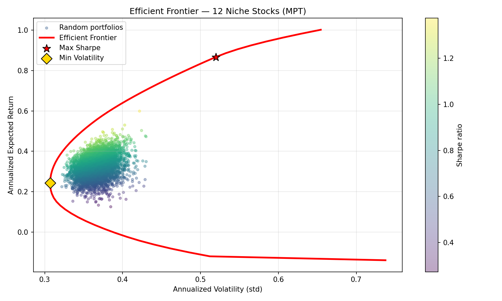

# Modern Portfolio Theory (MPT) Optimizer

[](https://www.python.org/downloads/)
[](LICENSE)
[](https://github.com/ranaroussi/yfinance)
[](https://scipy.org/)

Find the **exact asset weights that maximize the Sharpe Ratio** across a universe of 12 niche growth stocks — and trace the full **Efficient Frontier** with `scipy.optimize`.



## Features

- **Live market data** — pulls 3 years of daily prices via `yfinance` (no API key needed)
- **Return statistics** — daily returns, annualized expected returns (`mean × 252`), annualized covariance matrix (`cov × 252`)
- **Efficient Frontier** — traces the optimal risk/return curve by minimizing volatility over a grid of target returns (SLSQP, long-only, fully invested)
- **Max Sharpe portfolio** — numerically finds the tangency portfolio that maximizes `(return − rf) / volatility`
- **Min Volatility portfolio** — the leftmost point on the frontier, for comparison
- **Monte-Carlo context** — 5,000 random portfolios plotted behind the frontier, colored by Sharpe ratio
- **Reproducible outputs** — optimal weights exported to CSV, frontier saved as PNG

## Stock Universe

12 niche / thematic growth names across clean energy, biotech, cloud, and fintech:

| Ticker | Company | Theme |
|--------|---------|-------|
| CELH | Celsius Holdings | Consumer / energy drinks |
| ENPH | Enphase Energy | Solar microinverters |
| FSLR | First Solar | Solar manufacturing |
| CRSP | CRISPR Therapeutics | Gene editing |
| BEAM | Beam Therapeutics | Gene editing |
| ROKU | Roku | Streaming |
| ETSY | Etsy | E-commerce |
| PLTR | Palantir | AI / data analytics |
| NET | Cloudflare | Cloud / edge |
| DDOG | Datadog | Cloud observability |
| U | Unity Software | Gaming / 3D engine |
| AFRM | Affirm Holdings | Fintech / BNPL |

## Methodology

For weight vector **w**, expected-return vector **μ**, and covariance matrix **Σ**:

- Portfolio return: `μ_p = wᵀμ`
- Portfolio volatility: `σ_p = √(wᵀΣw)`
- Sharpe ratio: `(μ_p − rf) / σ_p`

Optimizations (long-only `0 ≤ w ≤ 1`, fully invested `Σw = 1`):

| Portfolio | Objective | Constraint |
|-----------|-----------|------------|
| Max Sharpe | minimize `−Sharpe(w)` | `Σw = 1` |
| Min Volatility | minimize `σ(w)` | `Σw = 1` |
| Frontier point | minimize `σ(w)` | `Σw = 1`, `wᵀμ = target` |

## Quickstart

```bash
git clone https://github.com/maanas-pab/modern-portfolio-theory-mpt-optimizer.git
cd modern-portfolio-theory-mpt-optimizer
pip install -r requirements.txt
python mpt_optimizer.py
```

With options:

```bash
python mpt_optimizer.py --period 5y --risk-free 0.03 --points 80 --tickers AAPL MSFT NVDA
```

| Flag | Default | Description |
|------|---------|-------------|
| `--period` | `3y` | History window (`1y`, `3y`, `5y`, `max`, …) |
| `--interval` | `1d` | Price interval (`1d`, `1wk`, …) |
| `--risk-free` | `0.02` | Risk-free rate for Sharpe ratio |
| `--points` | `60` | Frontier resolution (target-return grid) |
| `--tickers` | 12 defaults | Custom universe (space-separated) |
| `--no-plot` | off | Skip chart generation |

## Sample Results

3-year window ending Sep 2026, risk-free rate 2%:

**Max Sharpe portfolio** — return 86.70%, volatility 51.97%, Sharpe **1.630**

| Ticker | Weight |
|--------|--------|
| PLTR | 58.83% |
| NET | 38.43% |
| AFRM | 2.74% |

**Min Volatility portfolio** — return 24.33%, volatility 30.69%, Sharpe 0.727

| Ticker | Weight |
|--------|--------|
| ETSY | 25.12% |
| FSLR | 18.73% |
| DDOG | 17.66% |
| CELH | 14.61% |
| ROKU | 8.32% |
| NET | 6.78% |
| CRSP | 6.76% |
| PLTR | 2.02% |

Equal-weight baseline: return 32.63%, volatility 35.55%, Sharpe 0.862 — both optimized portfolios dominate it on their respective objectives.

## Project Structure

```
├── mpt_optimizer.py        # Fetch → statistics → optimize → frontier → plot
├── requirements.txt        # numpy, pandas, scipy, yfinance, matplotlib
├── efficient_frontier.png  # Example output chart
├── max_sharpe_weights.csv  # Example optimal weights
├── min_vol_weights.csv     # Example min-vol weights
├── LICENSE                 # MIT
└── README.md
```

## Tech Stack

- **yfinance** — historical price data
- **pandas / numpy** — returns, expected returns, covariance matrix
- **scipy.optimize (SLSQP)** — Sharpe maximization + frontier tracing
- **matplotlib** — frontier visualization

## Limitations & Next Steps

- Expected returns are backward-looking sample means — noisy estimators of future returns
- Single-period, long-only model (no shorting, leverage, transaction costs, or taxes)
- Ideas: Black-Litterman views, Ledoit-Wolf shrinkage, max-drawdown / CVaR constraints, rolling backtests, Streamlit dashboard

## Disclaimer

Educational project — not investment advice. Past performance does not predict future results.
