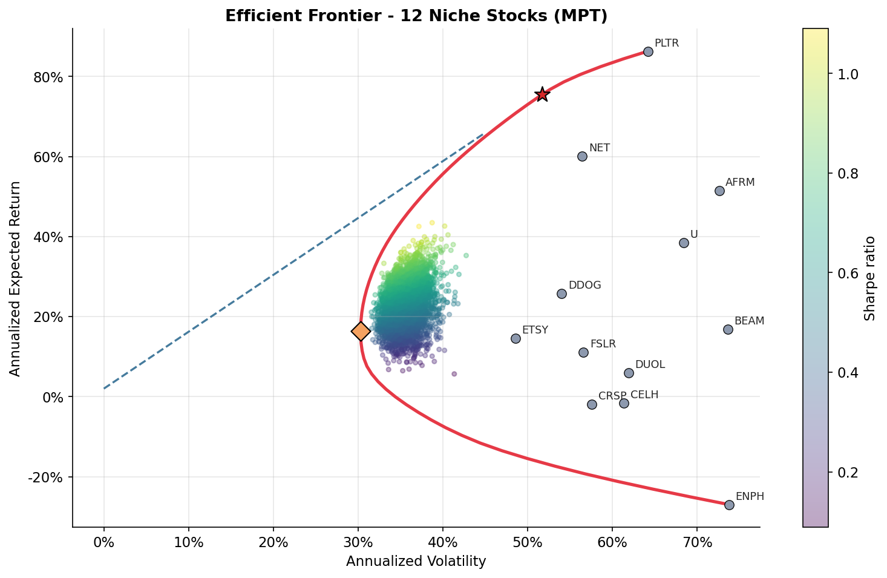

# Modern Portfolio Theory (MPT) Optimizer

Find the **exact asset weights that maximize the Sharpe Ratio** across a universe of 12 niche growth stocks — trace the full **Efficient Frontier** with `scipy.optimize`, stress-test it with a **rebalancing backtest**, validate it honestly with **walk-forward out-of-sample windows**, and explore **30 charts** of risk, return, and correlation.

