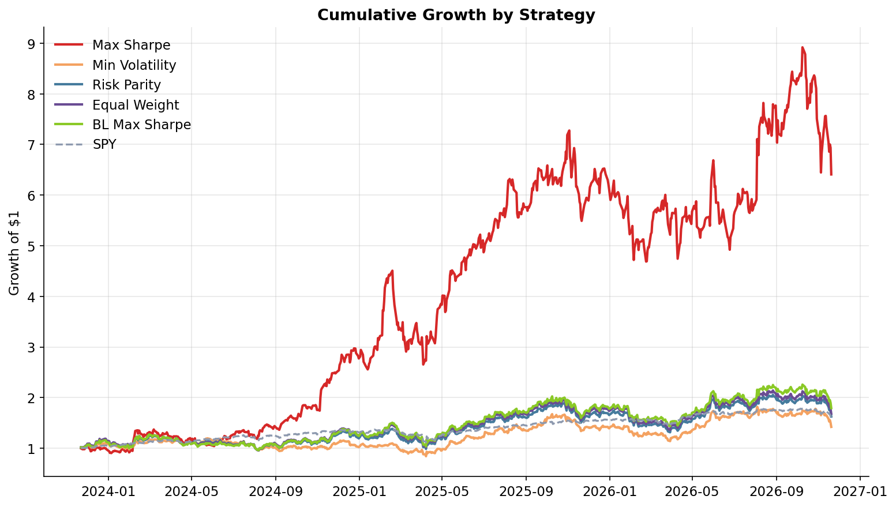
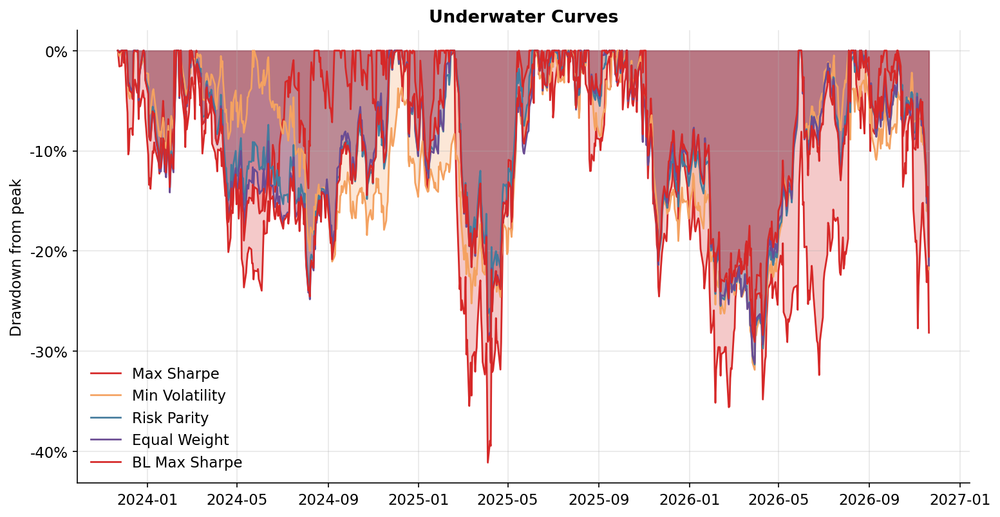
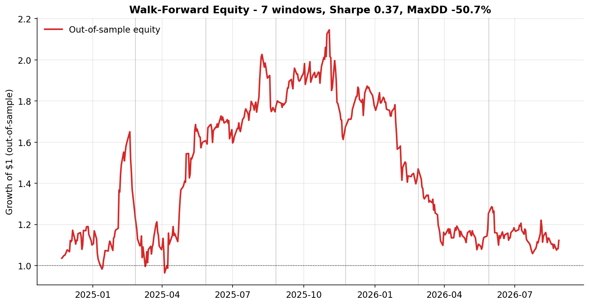

# Modern Portfolio Theory (MPT) Optimizer

[](https://www.python.org/downloads/)
[](https://github.com/maanas-pab/modern-portfolio-theory-mpt-optimizer/actions/workflows/ci.yml)
[](#testing)
[](docs/charts.md)
[](LICENSE)

Find the **exact asset weights that maximize the Sharpe Ratio** across a universe of 12 niche growth stocks — trace the full **Efficient Frontier** with `scipy.optimize`, stress-test it with a **rebalancing backtest**, validate it honestly with **walk-forward out-of-sample windows**, and explore **30 charts** of risk, return, and correlation.


## Highlights

- **Live or cached data** — pulls 3 years of daily prices via `yfinance`, or runs fully offline from the bundled `data/prices_3y.csv`
- **Five strategies** — Max Sharpe, Min Volatility, **Risk Parity** (equal risk budgeting), Equal Weight, and an optional **Black-Litterman** max-Sharpe, all compared against buy-and-hold
- **Honest evaluation** — `--walk-forward` re-fits on rolling train windows and reports only out-of-sample returns; the in-sample Sharpe of 1.42 becomes **0.37 out-of-sample**, and the gap is printed every run
- **30 charts** — frontier with capital market line, correlation & covariance heatmaps, cumulative growth, underwater drawdowns, rolling volatility/Sharpe/beta, monthly/quarterly/annual views, VaR/CVaR, risk contributions, turnover, concentration drift, sector exposure, weight drift — [see the full gallery](docs/charts.md)
- **15+ risk metrics** — Sharpe, Sortino, Calmar, max drawdown, VaR, CVaR, beta, alpha, HHI concentration and more
- **Ledoit-Wolf shrinkage** — `--shrinkage` conditions the covariance matrix before optimizing
- **Backtesting engine** — weekly/monthly/quarterly rebalancing with transaction costs
- **293 offline tests + CI** — synthetic fixtures, GitHub Actions across Python 3.9–3.12

## A tour of the gallery

| | |
|:--:|:--:|
|  |  |
| *Correlation matrix — CRSP/BEAM and NET/DDOG are the diversification failures* | *Growth of $1 by strategy (monthly rebalance, 10 bps)* |
|  |  |
| *Underwater curves* | *Monthly return calendar* |
|  |  |
| *Out-of-sample equity from rolling train/test windows* | *Frontier sensitivity to covariance shrinkage* |

**[Full 30-chart gallery →](docs/charts.md)**

## Stock Universe

12 niche / thematic growth names across clean energy, biotech, cloud, fintech and edtech:

| Ticker | Company | Theme |
|--------|---------|-------|
| CELH | Celsius Holdings | Consumer / energy drinks |
| ENPH | Enphase Energy | Solar microinverters |
| FSLR | First Solar | Solar manufacturing |
| CRSP | CRISPR Therapeutics | Gene editing |
| BEAM | Beam Therapeutics | Gene editing |
| DUOL | Duolingo | Edtech / language learning |
| ETSY | Etsy | E-commerce |
| PLTR | Palantir | AI / data analytics |
| NET | Cloudflare | Cloud / edge |
| DDOG | Datadog | Cloud observability |
| U | Unity Software | Gaming / 3D engine |
| AFRM | Affirm Holdings | Fintech / BNPL |

`SPY` is fetched alongside as the benchmark for beta/alpha.

## Methodology (short version)

For weight vector **w**, expected-return vector **μ**, and covariance matrix **Σ**:

- Portfolio return `μ_p = wᵀμ`, volatility `σ_p = √(wᵀΣw)`, Sharpe `(μ_p − rf) / σ_p`
- Optimizations are SLSQP, long-only `0 ≤ w ≤ 1`, fully invested `Σw = 1`
- Optional Ledoit-Wolf shrinkage: `Σ_shrunk = (1−λ)Σ + λμI`

Full derivations, metric definitions and assumptions: **[docs/methodology.md](docs/methodology.md)**.

## Quickstart

```bash
git clone https://github.com/maanas-pab/modern-portfolio-theory-mpt-optimizer.git
cd modern-portfolio-theory-mpt-optimizer
pip install -r requirements.txt
python3 -m mpt.cli            # or: make run
```

The first run downloads prices into `data/prices_3y.csv`; every run
after that is instant and offline. The original single-file entry
point still works: `python3 mpt_optimizer.py`.

### CLI reference

```bash
python3 -m mpt.cli --period 5y --risk-free 0.03 --points 80 \
    --shrinkage --rebalance monthly --cost 0.001
```

| Flag | Default | Description |
|------|---------|-------------|
| `--period` | `3y` | History window (`1y`, `3y`, `5y`, `max`, …) |
| `--interval` | `1d` | Price interval (`1d`, `1wk`, …) |
| `--tickers` | 12 defaults | Custom universe (space-separated) |
| `--risk-free` | `0.02` | Risk-free rate for Sharpe/Sortino |
| `--points` | `60` | Frontier resolution (target-return grid) |
| `--random` | `5000` | Monte-Carlo portfolios behind the frontier |
| `--shrinkage` | off | Ledoit-Wolf shrunk covariance |
| `--benchmark` | `SPY` | Benchmark for beta/alpha |
| `--black-litterman` | off | Add a Black-Litterman max-Sharpe strategy |
| `--rebalance` | `none` | `none` / `weekly` / `monthly` / `quarterly` |
| `--cost` | `0.0` | One-way transaction cost per unit turnover |
| `--walk-forward` | off | Rolling out-of-sample evaluation (no look-ahead) |
| `--train` | `252` | Walk-forward training window (days) |
| `--test` | `63` | Walk-forward test window (days) |
| `--cache` | `data/prices_3y.csv` | Price cache path |
| `--refresh` | off | Ignore cache, refetch from Yahoo |
| `--out-dir` | `outputs` | Weight CSV destination |
| `--figure-dir` | `figures` | Chart destination |
| `--no-plot` | off | Skip chart generation |
| `--no-backtest` | off | Skip the backtest |

## Sample results

3-year window ending 2026-11-20, risk-free 2%, sample covariance:

**Max Sharpe portfolio** — return 75.46%, volatility 51.70%, Sharpe **1.421**, Sortino 2.276

| Ticker | Weight |
|--------|--------|
| PLTR | 60.02% |
| NET | 37.31% |
| AFRM | 1.69% |
| U | 0.98% |

**Min Volatility portfolio** — return 16.37%, volatility 30.30%, Sharpe 0.474

| Ticker | Weight |
|--------|--------|
| ETSY | 24.33% |
| FSLR | 18.51% |
| DDOG | 17.96% |
| CELH | 13.39% |
| CRSP | 9.38% |
| NET | 7.66% |
| DUOL | 6.39% |
| PLTR | 1.97% |
| ENPH | 0.42% |

Equal-weight baseline: return 23.34%, volatility 34.44%, Sharpe 0.620 —
max Sharpe dominates on return and Sharpe, min vol on risk.

### Backtest (monthly rebalance, 10 bps cost)

| | Max Sharpe | Min Vol | Risk Parity | Equal Weight | Buy & Hold |
|---|---|---|---|---|---|
| Total return | 511.3% | 37.5% | 57.4% | 62.8% | 70.5% |
| Annual return | 74.1% | 15.3% | 20.7% | 22.3% | 25.3% |
| Sharpe | 1.388 | 0.437 | 0.564 | 0.588 | 0.604 |
| Max drawdown | -41.3% | -33.4% | -32.8% | -32.6% | -37.8% |
| Rebalances / cost | 36 / 0.21% | 36 / 0.36% | 36 / 0.41% | 36 / 0.41% | 0 / 0% |

See [docs/backtesting.md](docs/backtesting.md) for the model and its
caveats — these are **in-sample** weights, not a forecast.

### Walk-forward (honest, out-of-sample)

`--walk-forward --train 252 --test 63` re-fits the max-Sharpe weights on
each 1-year training window and holds them through the next quarter,
touching only data the optimizer had never seen:

| | In-sample | Out-of-sample |
|---|---|---|
| Annual return | 74.1% | 19.8% |
| Sharpe | 1.42 | 0.37 |
| Max drawdown | -41.1% | -50.7% |

The gap is not a bug — it is what overfitting to noisy expected-return
estimates costs. Any backtest that reports only the left column is
hiding the right one.

