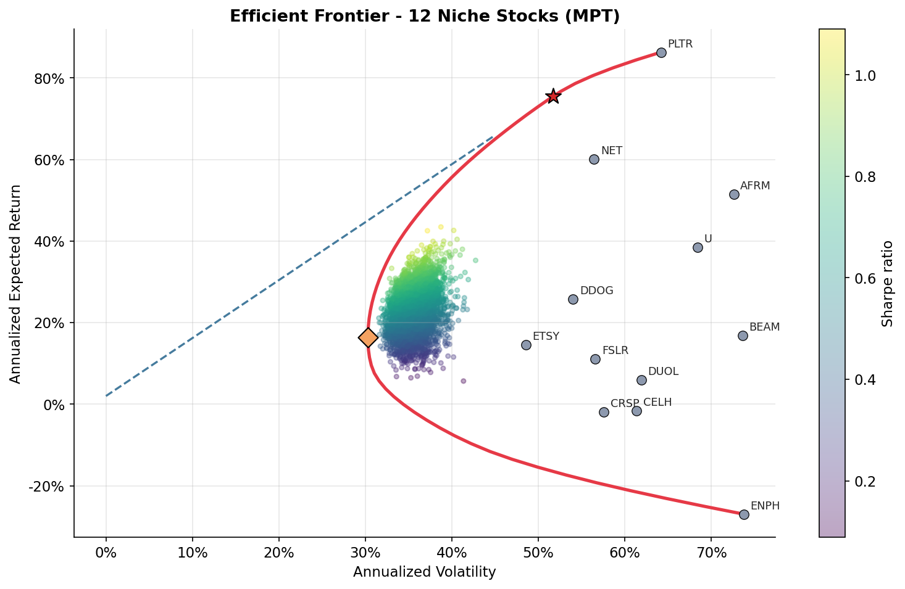
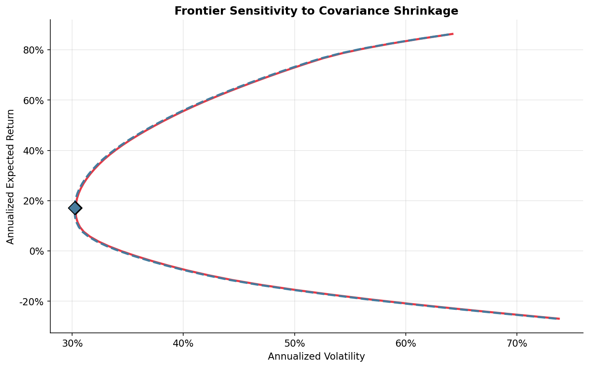

# Chart Gallery

Every figure the pipeline generates, what it shows, and which flag
controls it. Regenerate the whole gallery with:

```bash
make figures
```

## Frontier family



**Efficient frontier** — 5,000 random portfolios (colored by Sharpe),
the traced frontier, the capital market line from the risk-free rate
through the tangency portfolio, and all 12 assets in risk-return space.


**Anchor portfolios** — max Sharpe, min volatility and equal weight
on a minimal frontier, for slides and docs.


**Sharpe distribution** — histogram of the 5,000 random portfolios
with the optimized maximum marked. Shows how rare a top-decile
portfolio is by chance alone.



**Frontier sensitivity** — the same expected returns traced against the
sample covariance and against the Ledoit-Wolf shrunk covariance. The
gap between the two lines is how much the optimizer's answer depends
on a noisy covariance estimate.

